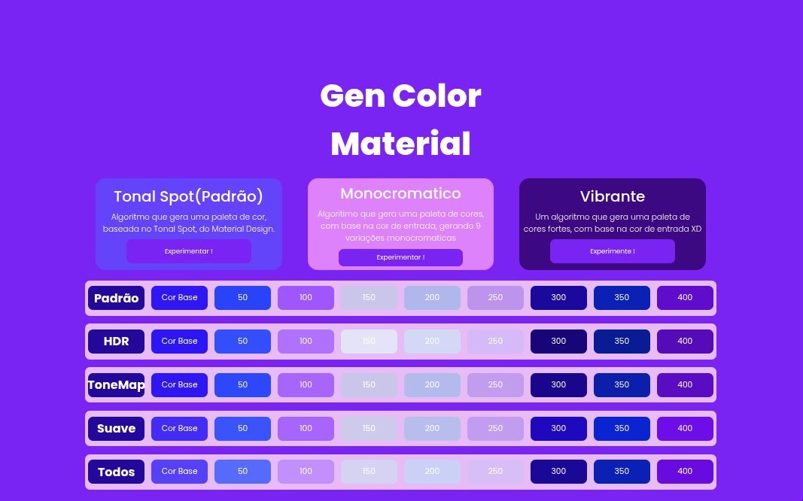
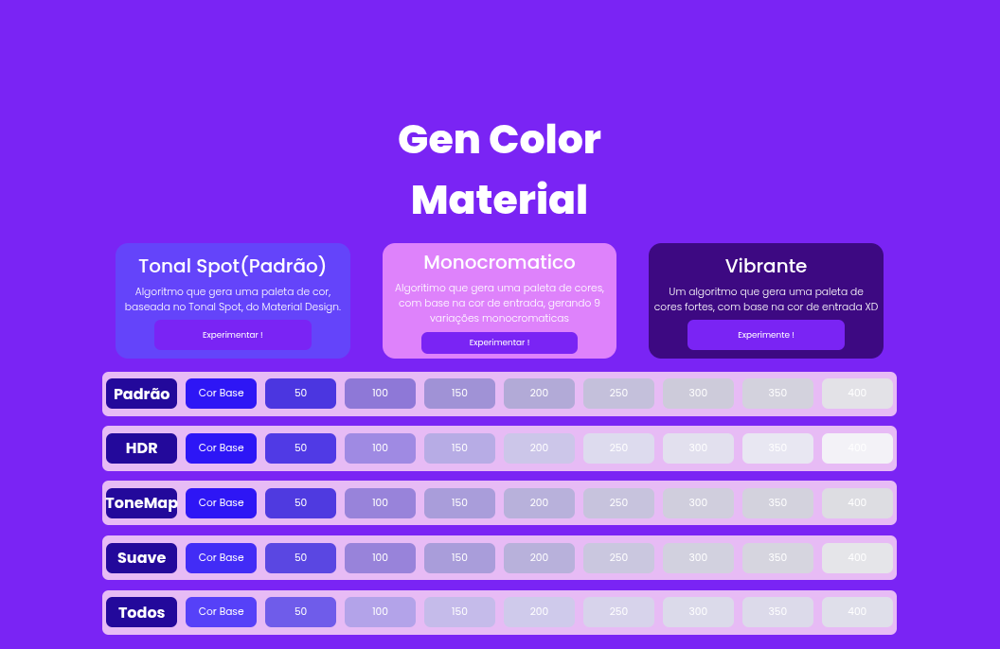
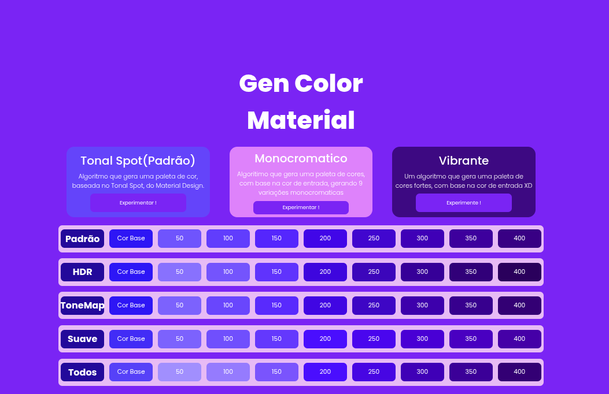

# GEN COLOR

**_Gerador de paletas_**

Uma biblioteca feita em JavaScript, inspirada no Material Design, permitindo gerar paletas de cores de forma dinâmica, fácil, rápida e flexível.

<div align="center">
  
</div>

# SOBRE

Eu sou muito ruim em criar temas nas minhas aplicações WEB, então decidi criar uma ferramenta simples, fácil, rápida e versátil para me ajudar a criar temas e aplicá-los de forma dinâmica. Passei alguns dias estudando sobre paletas de cores e temas, para conseguir criar este projeto.

Não é nada muito grandioso, apenas uma biblioteca simples, para me ajudar a estilizar meus sites de forma rápida e precisa.

# USO BÁSICO

A **API** é chamada de **genColor.js**, você pode importar com:

```js
import genColor from 'genColor/genColor.js';
```

Agora que temos a **API**, podemos usar da seguinte forma:

Configure a paleta que deseja gerar:

```js
// Exemplo
const myThemeConf = {
    color: '#6417ff',
    mode: 'default',
    postProcessing: [],
    colorOutput: 'rgb'
};
```

Agora, passe o objeto de configuração como argumento a **genColor**:

```js
const myTheme = genColor(myThemeConf);
```

Pronto, você tem sua primeira paleta funcional. Agora, se formos inspecionar **myTheme**, ele nos mostrará:

```js
{
  0: [ 102, 26, 255 ],
  50: [ 63, 46, 255 ],
  100: [ 201, 92, 255 ],
  150: [ 213, 201, 237 ],
  200: [ 182, 177, 241 ],
  250: [ 212, 149, 243 ],
  300: [ 56, 0, 168 ],
  350: [ 16, 0, 194 ],
  400: [ 150, 0, 224 ],
  debug: {
    postProcessing: [],
    colorOutput: 'rgb',
    inputColor: '#6417ff',
    modeGen: 'default'
  }
}
```

Você tem um objeto, com várias cores organizadas. Este é o uso mais básico, mas não se limite a apenas isso, porque existem algumas configurações que você pode aplicar, para embelezar seu projeto.

# EXPLICANDO PARÂMETROS

O objeto de configuração permite que a gente passe alguns parâmetros que nos ajudem a conseguir uma paleta de cores melhor.

## color:

Vamos começar pelo parâmetro **color**, este é o parâmetro de entrada, basicamente a cor base da sua paleta (ex: '#8214ff').

Ex:

```js
color: '#8214ff',
```

Não existem muitos motivos para me aprofundar, mas quero avisar algo importante: atualmente, **color** só suporta o formato de cor HEX ENTENDIDO. Qualquer valor que não seja um HEX entendido válido, a **API** retornará um erro, por segurança.

# mode:

## default:

Talvez esse seja um dos parâmetros mais importantes, pois ele define o perfil de geração de cores da paleta. O modo padrão é **default**, ele gera uma paleta de cores, baseado no Tonal Spot, do Material Design.

<div align="center">
  
</div>

## monocromatic:

Este modo gera uma paleta de cores monocromáticas, simples, né?

<div align="center">
  
</div>

Para usar, use:

```js
mode: 'monocromatic',
```

## vibrant

Caso queira transformar seu tema em uma salada de frutas colorida, esse modo é, sem dúvidas, o ideal. O modo vibrant gera uma paleta de cores vibrantes:

<div align="center">
  
</div>

Para usar, use:

```js
mode: 'vibrant',
```

# postProcessing:

O parâmetro **postProcessing: []** permite aplicar ajustes na paleta de cor. Atualmente, temos 3 opções.

## HDR

Este efeito tenta aumentar o contraste da imagem, usando uma fórmula adaptada de Smooth Step. Use:

```js
postProcessing: ['hdr'], // Escreva em maiúsculo, se se sentir confortável.
```

## ToneMap:

Este efeito tenta controlar a iluminação das cores, utilizando a fórmula adaptada de Smooth Step. Ele aplica ajustes sutis nas cores e limita a iluminação a min 10, max 90. Use:

```js
postProcessing: ['tonemap'],
```

## Smooth:

Este efeito tenta suavizar as cores de forma dinâmica, aumentando a iluminação. Use:

```js
postProcessing: ['smooth'],
```

## Observações:

Você pode usar mais de 1 efeito! Por exemplo, **['tonemap', 'smooth']**, assim, aplicamos um efeito de suavização de cores e um efeito de controle.

A ordem com que os efeitos são declarados no array de configuração importa!

Fiz isso para tornar mais customizável. Por exemplo, se você fizer:

Ex:

**['tonemap', 'hdr', 'smooth']**, irá aplicar o efeito de suavização primeiro, depois o efeito HDR e, por último, ToneMap.

Caso não queira usar nenhum efeito, apenas use:

```js
postProcessing: [] // Array vazio.
```

# colorOutput:

Por último, mas não menos importante, **colorOutput** define o tipo de cor de saída, com suporte a RGB, HEX ou HSL. Ex:

```js
colorOutput: 'hex'
```

Isso retornará as cores da paleta em HEX.

# Funcionamento interno:

Um resumo do funcionamento interno seria:

```text
Entrada -> Tratamento de dados -> Conversão para RGB -> Conversão para HSL -> Configuração do objeto com cores HSL modificadas -> Etapa de Pós-Processamento (se habilitado) -> Resultado final
```

Obviamente, tem mais coisa que isso. Isto é apenas uma simplificação. Caso queira descobrir o funcionamento interno, você pode ler os arquivos de configuração! Documentei cada função e estrutura interna para ajudar a entender o funcionamento desta simples biblioteca/API, para facilitar a modificação e criação de temas personalizados e efeitos de Pós-Processamento.


# Vantagens:
as vantagens são:

* Uso facil
* Flexivel e versatil
* Zero dependencias
* Facil de criar temas e modificar
* Geração de temas rapido
* Uso em paginas WEB e aplicações


# AUTOR:

Eu mesmo, Kojito Jacobe, fiz esta biblioteca! Fiz nos meus tempos livres e pretendo continuar atualizando e trazendo correções.

# Quer me ajudar?

Você pode me ajudar testando a biblioteca, relatando erros e sugerindo ideias!

# Tecnologias usadas:

Somente JS e JSON.

O projeto é Open Source, use da forma que desejar XD